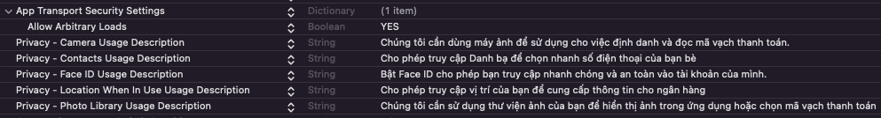
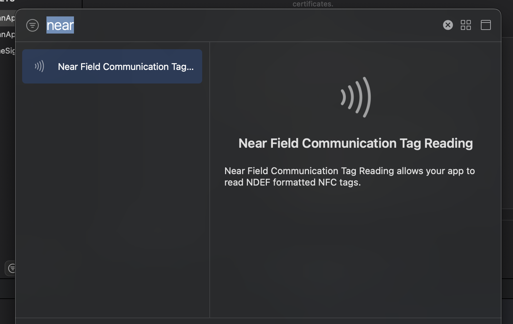
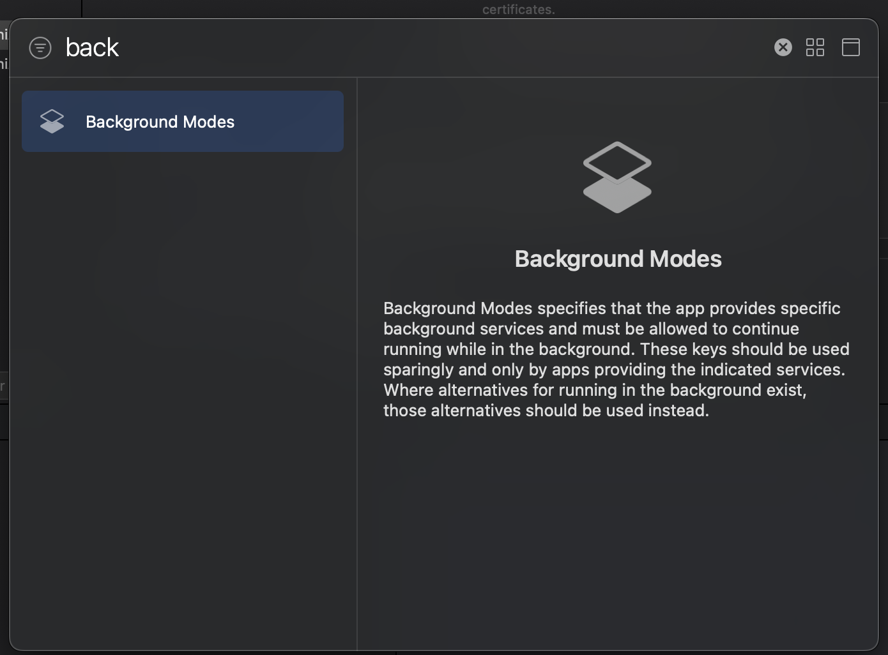
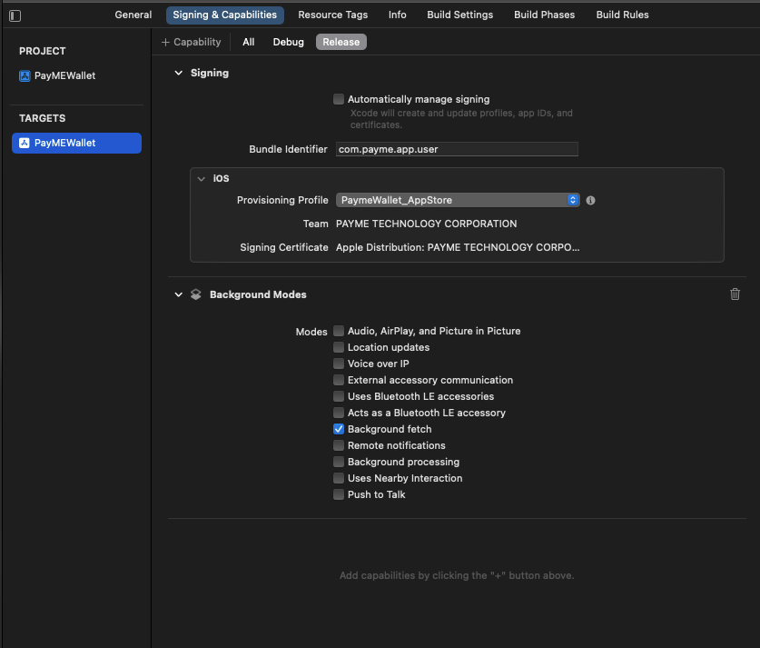

# PayME Miniapp Flutter

[Tiếng Việt](README.md) | **English**

The `payme_miniapp_flutter` Flutter plugin lets a partner app open PayME Miniapp (wallet, payment, top-up, withdrawal, transfer, bill payment, KYC) on iOS and Android.

| Component | Version |
| --- | --- |
| `payme_miniapp_flutter` (pub.dev) | **3.0.0** |
| PayME Miniapp iOS (CocoaPods `PayME-Miniapp`) | 0.8.1 |
| PayME Miniapp Android (`com.github.PayME-Miniapp:native-android`) | 0.8.2 |
| PayME SDK | 1.0.24 |

> [!IMPORTANT]
> 3.0.0 is a breaking release relative to 2.x: everything that used to take a phone number (`phone`) now takes an `identityToken`. See [Upgrading from 2.x](#upgrading-from-2x).

## Table of contents

- [Requirements](#requirements)
- [Installation](#installation)
  - [Add the package](#add-the-package)
  - [iOS: Podfile](#ios-podfile)
  - [Android: JitPack and Gradle](#android-jitpack-and-gradle)
- [App configuration](#app-configuration)
  - [iOS: Info.plist](#ios-infoplist)
  - [iOS: Capabilities](#ios-capabilities)
  - [iOS: Background fetch and AppDelegate](#ios-background-fetch-and-appdelegate)
  - [Android: permissions, Activity and ProGuard](#android-permissions-activity-and-proguard)
- [Quick start](#quick-start)
- [identityToken](#identitytoken)
- [API reference](#api-reference)
  - [About the returned Futures](#about-the-returned-futures)
  - [init](#init)
  - [open](#open)
  - [PayMEOpeningParam](#paymeopeningparam)
  - [Parameter classes](#parameter-classes)
  - [getBalance](#getbalance)
  - [getAccountInfo](#getaccountinfo)
  - [setLanguage](#setlanguage)
  - [close](#close)
  - [onResponse and onError](#onresponse-and-onerror)
  - [Constants](#constants)
- [Error codes](#error-codes)
- [Upgrading from 2.x](#upgrading-from-2x)
- [Changelog and support](#changelog-and-support)

## Requirements

| Item | Requirement |
| --- | --- |
| Dart SDK | `>=3.2.0 <4.0.0` |
| Flutter | `>=3.3.0` (your Flutter version must be able to build with Android Gradle Plugin 9, see below) |
| iOS | iOS 13.0 or later, **Xcode 26.2 or later**, CocoaPods |
| Android | `minSdkVersion` 26, `targetSdkVersion` 33 or later, `compileSdkVersion` 37 |
| Android build | JDK 17, Gradle 9.3.1, Android Gradle Plugin 9.1.1, Kotlin Gradle Plugin 2.2.20, NDK 28.2.13676358 |
| Account | `appId`, `publicKey`, `privateKey` issued by PayME; your server must be able to call PayME's `identityToken` API |

## Installation

### Add the package

```sh
flutter pub add payme_miniapp_flutter
```

or declare it in `pubspec.yaml`:

```yaml
dependencies:
  payme_miniapp_flutter: ^3.0.0
```

### iOS: Podfile

The plugin pulls in the `PayME-Miniapp` 0.8.1 pod. Some of its dependencies must be built as dynamic frameworks. Update `ios/Podfile`:

```ruby
platform :ios, '13.0'

target 'Runner' do
  use_frameworks!
  use_modular_headers!

  flutter_install_all_ios_pods File.dirname(File.realpath(__FILE__))

  $dynamic_frameworks = [
    'PayME-Miniapp', 'CryptoSwift', 'SwiftyRSA', 'GCDWebServer', 'NSLogger',
    'lottie-ios', 'SwiftyJSON', 'ZIPFoundation', 'Mixpanel-swift'
  ]

  pre_install do |installer|
    installer.pod_targets.each do |pod|
      if $dynamic_frameworks.include?(pod.name)
        def pod.build_type
          Pod::BuildType.dynamic_framework
        end
      end
    end
  end

  post_install do |installer|
    installer.pods_project.targets.each do |target|
      flutter_additional_ios_build_settings(target)
      target.build_configurations.each do |config|
        if $dynamic_frameworks.include?(target.name)
          config.build_settings['BUILD_LIBRARY_FOR_DISTRIBUTION'] = 'YES'
          config.build_settings['IPHONEOS_DEPLOYMENT_TARGET'] = '13.0'
        end
      end
    end
  end
end
```

Then run:

```sh
cd ios && pod install --repo-update
```

### Android: JitPack and Gradle

**1. Add JitPack.** The native Android library is published on JitPack, so your app project must declare that repository.

If your project declares repositories in `android/build.gradle`:

```groovy
allprojects {
    repositories {
        google()
        mavenCentral()
        maven { url "https://jitpack.io" }
    }
}
```

If your project uses `dependencyResolutionManagement` in `android/settings.gradle`:

```groovy
dependencyResolutionManagement {
    repositories {
        google()
        mavenCentral()
        maven { url = uri("https://jitpack.io") }
    }
}
```

**2. Android Gradle Plugin and Kotlin.** With the newer Flutter template, in `android/settings.gradle`:

```groovy
plugins {
    id "dev.flutter.flutter-plugin-loader" version "1.0.0"
    id "com.android.application" version "9.1.1" apply false
    id "org.jetbrains.kotlin.android" version "2.2.20" apply false
}
```

With the older template, in `android/build.gradle`:

```groovy
buildscript {
    ext.kotlin_version = "2.2.20"
    dependencies {
        classpath "com.android.tools.build:gradle:9.1.1"
        classpath "org.jetbrains.kotlin:kotlin-gradle-plugin:$kotlin_version"
    }
}
```

**3. Gradle Wrapper** (`android/gradle/wrapper/gradle-wrapper.properties`):

```properties
distributionUrl=https\://services.gradle.org/distributions/gradle-9.3.1-all.zip
```

**4. App module** (`android/app/build.gradle`):

```groovy
android {
    compileSdkVersion 37
    ndkVersion = "28.2.13676358"

    defaultConfig {
        minSdkVersion 26
        targetSdkVersion flutter.targetSdkVersion // must be 33 or later
    }
}
```

**5. `android/gradle.properties`:**

```properties
android.useAndroidX=true
android.enableJetifier=true
android.builtInKotlin=false
android.newDsl=false
android.uniquePackageNames=false
```

`android.builtInKotlin=false` and `android.newDsl=false` keep the project building with the Kotlin Gradle Plugin while Flutter and AGP 9 move to Built-in Kotlin. `android.uniquePackageNames=false` is a temporary workaround for the duplicate namespace between `com.google.ai.edge.litert:litert-support` and `com.google.ai.edge.litert:litert-support-api` when building with AGP 9.

## App configuration

### iOS: Info.plist

Add these keys to `ios/Runner/Info.plist`:



```xml
<key>LSApplicationQueriesSchemes</key>
<array>
  <string>vcbpartner</string>
</array>
<key>NSCameraUsageDescription</key>
<string>The app uses the camera for identity verification and payment code scanning</string>
<key>NSContactsUsageDescription</key>
<string>The app accesses your contacts so you can pick a phone number quickly</string>
<key>NSPhotoLibraryAddUsageDescription</key>
<string>The app saves QR code images to your photo library</string>
<key>NSPhotoLibraryUsageDescription</key>
<string>The app reads your photo library so you can pick a QR code image</string>
<key>NFCReaderUsageDescription</key>
<string>The app uses NFC to read your ID card chip during identity verification (eKYC)</string>
<key>com.apple.developer.nfc.readersession.iso7816.select-identifiers</key>
<array>
  <string>A0000002471001</string>
  <string>A0000002472001</string>
  <string>00000000000000</string>
</array>
```

| Key | Purpose |
| --- | --- |
| `LSApplicationQueriesSchemes` | Open the Vietcombank app (`vcbpartner`) for deeplink top-ups |
| `NSCameraUsageDescription` | Capture ID documents and face during KYC; scan QR codes |
| `NSContactsUsageDescription` | Pick a contact when topping up a phone |
| `NSPhotoLibraryUsageDescription` | Pick a QR code image from the library |
| `NSPhotoLibraryAddUsageDescription` | Save QR code images to the library |
| `NFCReaderUsageDescription` | Read the national ID card chip over NFC during KYC |
| `com.apple.developer.nfc.readersession.iso7816.select-identifiers` | ISO 7816 application identifiers for the NFC reader session |

### iOS: Capabilities

In Xcode, select the `Runner` target > **Signing & Capabilities** > click **+ Capability**, then add:

1. **Near Field Communication Tag Reading** (NFC-based KYC).

   

2. **Background Modes**, with **Background fetch** enabled (PayME Miniapp downloads updates in the background).

   

   

### iOS: Background fetch and AppDelegate

So that Miniapp can finish background update downloads, add a `handleEventsForBackgroundURLSession` handler to `ios/Runner/AppDelegate.swift`:

```swift
import Flutter
import UIKit

@main
@objc class AppDelegate: FlutterAppDelegate {
  override func application(
    _ application: UIApplication,
    didFinishLaunchingWithOptions launchOptions: [UIApplication.LaunchOptionsKey: Any]?
  ) -> Bool {
    GeneratedPluginRegistrant.register(with: self)
    return super.application(application, didFinishLaunchingWithOptions: launchOptions)
  }

  override func application(
    _ application: UIApplication,
    handleEventsForBackgroundURLSession identifier: String,
    completionHandler: @escaping () -> Void
  ) {
    completionHandler()
  }
}
```

If your AppDelegate is written in Objective-C (`AppDelegate.m`):

```objective-c
- (void)application:(UIApplication *)application
    handleEventsForBackgroundURLSession:(NSString *)identifier
                      completionHandler:(void (^)(void))completionHandler {
  completionHandler();
}
```

### Android: permissions, Activity and ProGuard

- **Permissions:** the native library already declares the permissions it needs (Internet, camera, contacts, NFC, ...) in its own manifest; Gradle merges them into your app. You do not need to add any.
- **Activity:** keep `MainActivity` as `FlutterActivity`; there is no need to switch to `FlutterFragmentActivity`. On Android the plugin always opens Miniapp in its own full-screen Activity.
- **ProGuard / R8:** if you enable `minifyEnabled true`, add to `android/app/proguard-rules.pro`:

```proguard
-keep class vn.kalapa.ekyc.**{*;}
-keep class com.fis.ekyc.**{*;}
-keep class com.fis.nfc.**{*;}
-keep class retrofit2.**{*;}

-keepclassmembers,allowobfuscation class * {
    @com.google.gson.annotations.SerializedName <fields>;
}
```

## Quick start

```dart
import 'package:flutter/foundation.dart';
import 'package:payme_miniapp_flutter/payme_miniapp_flutter.dart';
import 'package:payme_miniapp_flutter/payme_miniapp_type.dart';

/// Ask your server for an identityToken (see identityToken below).
Future<String> fetchIdentityToken() async => throw UnimplementedError();

void setUpPayME() {
  PaymeMiniappFlutter.onResponse.listen((event) => debugPrint('PayME response: $event'));
  PaymeMiniappFlutter.onError.listen((event) => debugPrint('PayME error: $event'));
  PaymeMiniappFlutter.init('<APP_ID>', '<PUBLIC_KEY>', '<PRIVATE_KEY>',
      env: PayMEEnv.SANDBOX, mode: PayMEMode.MINIAPP_SANDBOX);
}

Future<void> openWallet() async {
  final identityToken = await fetchIdentityToken();
  PaymeMiniappFlutter.open(
      PayMEOpeningType.screen, PayMEOpeningParam.open(identityToken: identityToken));
}
```

Call `setUpPayME()` once, as early as possible during app startup (for example in the root screen's `initState`): `init` also checks for and downloads the latest Miniapp bundle. Results and errors of every operation arrive on the `onResponse` and `onError` streams, not as return values.

## identityToken

An `identityToken` is a string signed by the PayME backend for one of the partner's users. Starting with 3.0.0, Miniapp identifies the user with this string instead of a phone number.

**Three-step flow**

1. **Your server gets the token.** Your server calls PayME's `identityToken/init` API (server-to-server) with the user's phone number. Contact PayME for this API's documentation. Never call it from the app.
2. **The app receives the token.** The app fetches the `identityToken` from your server over a channel that authenticates the user.
3. **Open Miniapp.** Pass the token to `PayMEOpeningParam` (or to `getBalance`, `getAccountInfo`).

**Lifetime**

- A token is valid for **15 minutes** from issue and can be reused any number of times within that window.
- Invalid or expired token: `onError` emits `code` `"401"`. Fetch a new token from your server and retry.
- Empty token on an operation that requires one: `onError` emits `code` `"IDENTITY_TOKEN_REQUIRED"`.

**When it is needed**

| Operation | identityToken |
| --- | --- |
| `PayMEOpeningParam.payme()` | Not used. The user enters a phone number and signs in with a PIN. |
| `PayMEOpeningParam.payment(...)` | Optional. With it, the user can pay from the PayME wallet. Without it, the user pays as a guest (card, QR). |
| All other `PayMEOpeningParam` constructors, `getBalance`, `getAccountInfo` | Required |

**Security**

- Keep the token in memory only. Do not log it, persist it on the device (SharedPreferences, files, databases), or put it in URLs or analytics.
- Never ship `privateKey` or the credentials for `identityToken/init` in the app; only your server holds them.

## API reference

All methods are `static` on the `PaymeMiniappFlutter` class (`package:payme_miniapp_flutter/payme_miniapp_flutter.dart`). Parameter classes and constants live in `package:payme_miniapp_flutter/payme_miniapp_type.dart`.

### About the returned Futures

- Every method returns `Future<dynamic>` that **carries no data**. Results and business errors arrive on [`onResponse` and `onError`](#onresponse-and-onerror).
- The plugin catches every `PlatformException` coming from native code, prints it with `debugPrint` and returns `null`. Your code **never receives an exception** from these calls (see [Error codes](#error-codes)).
- On some platforms the Future may never complete (for example `init` and `open` on iOS). Do not put important logic after `await` on these calls; just call them.

### init

```dart
static Future<dynamic> init(String appId, String publicKey, String privateKey,
    {String? locale = PayMELocale.VI,
    String? env = PayMEEnv.PRODUCTION,
    String? mode = 'miniapp_product'});
```

| Parameter | Required | Type | Default | Description |
| --- | --- | --- | --- | --- |
| `appId` | Yes | `String` | | App ID issued by PayME (the `x-api-client` value on the dashboard) |
| `publicKey` | Yes | `String` | | RSA public key issued by PayME, on a single line (strip line breaks) |
| `privateKey` | Yes | `String` | | Partner RSA private key, on a single line |
| `locale` | No | `String` | `PayMELocale.VI` | Initial language: `PayMELocale.VI`, `PayMELocale.EN` |
| `env` | No | `String` | `PayMEEnv.PRODUCTION` | `PayMEEnv.SANDBOX` or `PayMEEnv.PRODUCTION` |
| `mode` | No | `String` | `PayMEMode.MINIAPP_PRODUCT` | `PayMEMode.MINIAPP_SANDBOX` or `PayMEMode.MINIAPP_PRODUCT`; use the one that matches `env` |

> [!WARNING]
> Never commit real keys to public source code, READMEs or screenshots. Use the key set PayME issues for each environment.

### open

```dart
static Future<dynamic> open(String type, PayMEOpeningParam openingParam);
```

| Parameter | Required | Type | Description |
| --- | --- | --- | --- |
| `type` | Yes | `String` | `PayMEOpeningType.screen` (full screen) or `PayMEOpeningType.modal` (bottom sheet). On Android the plugin always opens full screen. |
| `openingParam` | Yes | `PayMEOpeningParam` | The operation to open, built with one of the named constructors below |

```dart
void payOrder(String identityToken) {
  PaymeMiniappFlutter.open(
    PayMEOpeningType.screen,
    PayMEOpeningParam.pay(
      identityToken: identityToken,
      data: PayMEPaymentParam(amount: 10000, transactionId: '<PARTNER_ORDER_ID>'),
    ),
  );
}
```

### PayMEOpeningParam

| Named constructor | Action | `identityToken` | `data` | Description |
| --- | --- | --- | --- | --- |
| `PayMEOpeningParam.payme()` | `PAYME` | Not used | None | Open the PayME wallet; the user signs in with phone number and PIN |
| `PayMEOpeningParam.open(identityToken:)` | `OPEN` | Required | None | Open the wallet home; activates the wallet if the user has none |
| `PayMEOpeningParam.pay(identityToken:, data:)` | `PAY` | Required | `PayMEPaymentParam` (required) | Pay for an order |
| `PayMEOpeningParam.payment(identityToken:, data:)` | `PAYMENT` | Optional | `PayMEPaymentDirectParam` (required) | Pay a transaction the partner already created through the PayME API |
| `PayMEOpeningParam.transferQR(identityToken:, data:)` | `TRANSFER_QR` | Required | `PayMETransferQRParam` (required) | Transfer from the PayME wallet to a destination bank account |
| `PayMEOpeningParam.service(identityToken:, data:)` | `SERVICE` | Required | `PayMEServiceParam` (required) | Pay a bill or buy a service (power, water, cards, ...) |
| `PayMEOpeningParam.deposit(identityToken:, data:)` | `DEPOSIT` | Required | `PayMEPayParam` (required) | Top up the wallet |
| `PayMEOpeningParam.withdraw(identityToken:, data:)` | `WITHDRAW` | Required | `PayMEPayParam` (required) | Withdraw from the wallet |
| `PayMEOpeningParam.transfer(identityToken:, data:)` | `TRANSFER` | Required | `PayMEPayParam` (required) | Transfer money |
| `PayMEOpeningParam.kyc(identityToken:)` | `KYC` | Required | None | Open the identity verification (KYC) flow |

For `PAYMENT`, the partner fetches the payment methods and creates the transaction through the PayME API (contact PayME), then passes the transaction code in `PayMEPaymentDirectParam.transaction`.

Examples:

```dart
void buildParams(String identityToken) {
  // PayME wallet, no identityToken needed
  final wallet = PayMEOpeningParam.payme();

  // Pay an existing transaction; omit identityToken to pay as a guest
  final payment = PayMEOpeningParam.payment(data: PayMEPaymentDirectParam(transaction: '<TRANSACTION>'));

  // Transfer to a bank account
  final transferQR = PayMEOpeningParam.transferQR(
    identityToken: identityToken,
    data: PayMETransferQRParam(
      amount: 20000,
      bankNumber: '<BANK_ACCOUNT_NUMBER>',
      swiftCode: '<SWIFT_CODE>',
      cardHolder: '<ACCOUNT_HOLDER_NAME>',
    ),
  );

  // Pay an electricity bill
  final service = PayMEOpeningParam.service(identityToken: identityToken, data: PayMEServiceParam(service: 'POWE'));

  // Top up
  final deposit = PayMEOpeningParam.deposit(identityToken: identityToken, data: PayMEPayParam(amount: 10000));
}
```

### Parameter classes

Amounts are in VND and must be whole numbers (even where the Dart type is `double`).

**`PayMEPaymentParam`** (for `pay`)

| Property | Required | Type | Description |
| --- | --- | --- | --- |
| `amount` | Yes | `int` | Transaction amount |
| `transactionId` | Yes | `String` | Partner transaction ID |
| `note` | No | `String?` | Note |
| `ipnUrl` | No | `String?` | URL the PayME server calls (IPN) when the transaction succeeds or fails |
| `isShowResult` | No | `bool?` | Show PayME's result screen (default `true`) |

**`PayMEPaymentDirectParam`** (for `payment`)

| Property | Required | Type | Description |
| --- | --- | --- | --- |
| `transaction` | Yes | `String` | Transaction code created through the PayME API |
| `isShowResult` | No | `bool?` | Show PayME's result screen (default `true`) |

**`PayMETransferQRParam`** (for `transferQR`)

| Property | Required | Type | Description |
| --- | --- | --- | --- |
| `amount` | Yes | `double` | Amount (pass `0` to let the user enter it) |
| `bankNumber` | Yes | `String` | Destination account or card number |
| `swiftCode` | Yes | `String` | SWIFT code of the destination bank |
| `cardHolder` | Yes | `String` | Account holder name |
| `note` | No | `String?` | Note |
| `partnerTransaction` | No | `String?` | Partner transaction ID |
| `extraData` | No | `Map<String, dynamic>?` | Arbitrary partner data, returned when the transaction succeeds |
| `isShowResult` | No | `bool?` | Show PayME's result screen (default `true`) |

**`PayMEServiceParam`** (for `service`)

| Property | Required | Type | Description |
| --- | --- | --- | --- |
| `service` | Yes | `String` | Service code (table below) |
| `isBackToApp` | No | `bool?` | Return to the partner app when done |
| `isShowResult` | No | `bool?` | Show PayME's result screen (default `true`) |

| Service code | Service |
| --- | --- |
| `POWE` | Electricity |
| `WATE` | Water |
| `ADSL` | Internet |
| `TIVI` | Television |
| `PPMB` | Postpaid mobile |
| `MOBILE_CARD` | Mobile prepaid card |
| `MOBILE_TOPUP` | Mobile top-up |
| `GAME_CARD` | Game card |

**`PayMEPayParam`** (for `deposit`, `withdraw`, `transfer`)

| Property | Required | Type | Description |
| --- | --- | --- | --- |
| `amount` | No | `double?` | Suggested amount |
| `description` | No | `String?` | Transaction description |
| `isBackToApp` | No | `bool?` | Return to the partner app when done |
| `isShowResult` | No | `bool?` | Show PayME's result screen (default `true`) |

### getBalance

```dart
static Future<dynamic> getBalance(String identityToken);
```

Gets the user's wallet balance. The result arrives on `onResponse` with `action` `GET_BALANCE`:

| Field | Type | Description |
| --- | --- | --- |
| `linked` | `bool` | Whether the user has linked a wallet to your app |
| `balance` | `int` | Balance in VND; present only when `linked` is `true` |
| `message` | `String` | Accompanying message |

### getAccountInfo

```dart
static Future<dynamic> getAccountInfo(String identityToken);
```

Gets the user's PayME account information. The result arrives on `onResponse` with `action` `GET_ACCOUNT_INFO`, together with the account fields returned by PayME (for example `accountId`).

Both methods report errors on `onError`: `"401"` when the `identityToken` is invalid or expired, `"IDENTITY_TOKEN_REQUIRED"` when it is empty.

### setLanguage

```dart
static Future<dynamic> setLanguage(String language);
```

Changes the Miniapp language after `init`. `language` is `PayMELocale.VI` (`'vi'`) or `PayMELocale.EN` (`'en'`).

### close

```dart
static Future<dynamic> close();
```

Closes the open Miniapp. **Currently Android only**; the iOS side of the plugin does not implement it yet (the call is ignored).

### onResponse and onError

```dart
static Stream<dynamic> get onResponse;
static Stream<dynamic> get onError;
```

Both are broadcast streams. Subscribe once before calling `open`, `getBalance` or `getAccountInfo`, and cancel the `StreamSubscription` when you no longer need it.

| Stream | Event type | Content |
| --- | --- | --- |
| `onResponse` | `Map` | `action` (`String`) plus the result fields of that operation, e.g. `{action: GET_BALANCE, linked: true, balance: 150000, message: ...}` |
| `onError` | `Map` | `{action: String, code: String, description: String}` |
| `onError` (Android only, plugin-side errors) | `String` | Error message, e.g. `Missing info`, `Missing action` |

`action` values: `PAYME`, `OPEN`, `PAY`, `PAYMENT`, `TRANSFER_QR`, `SERVICE`, `DEPOSIT`, `WITHDRAW`, `TRANSFER`, `KYC`, `GET_BALANCE`, `GET_ACCOUNT_INFO`.

```dart
final errorSub = PaymeMiniappFlutter.onError.listen((event) {
  if (event is! Map) {
    debugPrint('PayME plugin error: $event'); // Android: plugin-side parameter error
    return;
  }
  final code = event['code'] as String?;
  switch (code) {
    case '401':
    case 'IDENTITY_TOKEN_REQUIRED':
      // Fetch a new identityToken from your server and reopen Miniapp.
      break;
    case 'USER_CANCEL':
      // Miniapp was closed; usually nothing to report to the user.
      break;
    default:
      debugPrint('PayME ${event['action']} failed with $code: ${event['description']}');
  }
});

// When no longer needed:
// errorSub.cancel();
```

### Constants

| Class | Constants | Values |
| --- | --- | --- |
| `PayMEEnv` | `SANDBOX`, `PRODUCTION` | `'SANDBOX'`, `'PRODUCTION'` |
| `PayMEMode` | `MINIAPP_SANDBOX`, `MINIAPP_PRODUCT` | `'miniapp_sandbox'`, `'miniapp_product'` |
| `PayMELocale` | `VI`, `EN` | `'vi'`, `'en'` |
| `PayMEOpeningType` | `screen`, `modal` | `'screen'`, `'modal'` |

## Error codes

**Errors on `onError`** (`event['code']`)

| Code | When | How to handle |
| --- | --- | --- |
| `401` | Invalid or expired `identityToken` (opening Miniapp, `getBalance`, `getAccountInfo`). Miniapp closes itself. | Fetch a new `identityToken` from your server and retry. |
| `IDENTITY_TOKEN_REQUIRED` | Empty `identityToken` on an operation that requires one | Check how you obtain the token; do not open Miniapp without one. |
| `USER_CANCEL` | Miniapp was closed (the user closed or left it) | Treat it as a "Miniapp closed" event, not a system failure. On iOS this code is sent every time the Miniapp screen closes. |
| `SYSTEM_CANCEL` | (iOS) Miniapp could not start | Try again; report to PayME if it persists. |
| `CONNECTION_LOST`, `TIMED_OUT`, `NO_RESPONSE` | Network failure or no response from the server | Ask the user to check the connection and retry. |
| `ENCODE_FAILED`, `DECODE_FAILED` | Encryption or decryption failure, usually wrong keys or environment | Check `appId`, the key pair and the `env`/`mode` pair. |
| `SERVER` (iOS), `SERVER_ERROR` (Android) | The PayME server returned an error | Retry later; show `description`. |
| `OTHER` | Other errors (for example account information not found) | Show `description`. |
| Any other code | Business error reported by Miniapp | Show `description`; contact PayME if you need it looked up. |

**Plugin-side errors (`PlatformException`)**

These codes are returned by the plugin's native layer over the MethodChannel. The plugin catches them in Dart, only prints them with `debugPrint` (as `Error invoking method: PlatformException(...)`), and the Future returns `null`; your code does not receive an exception. On Android some of these cases also emit a `String` on `onError`. Validate parameters before calling and watch the debug log while integrating.

| Code | Platform | When | How to handle |
| --- | --- | --- | --- |
| `MISSING_INFO` | iOS, Android | Missing arguments (`init` without keys; `getBalance`/`getAccountInfo`/`setLanguage` without an argument) | Pass all arguments. |
| `INVALID_PARAM` | iOS | `data` missing or of the wrong shape for the action (e.g. `pay` without `amount`, non-whole amount) | Pass the right parameter class with its required fields. |
| `PAYME_NOT_INITIALIZED` | iOS | `open`/`getBalance`/`getAccountInfo`/`setLanguage` called before `init` | Call `init` at app startup. |
| `JSON_PARSE_ERROR` | Android | `init` received invalid arguments (e.g. `locale`, `env` or `mode` set to `null`) | Do not pass `null`; omit the argument to use the default. |
| `ERROR` | Android | Unexpected failure in `open` | Check the log; report to PayME with reproduction details. |

> [!NOTE]
> On Android, if the required `data` is missing for `pay`, `payment`, `transferQR` or `service`, the plugin does not report `INVALID_PARAM`; it opens the PayME wallet instead. Always pass `data` for these actions.

## Upgrading from 2.x

| 2.x (native SDK iOS 0.7.6 / Android 0.7.2) | 3.0.0 (native SDK iOS 0.8.1 / Android 0.8.2) |
| --- | --- |
| `PayMEOpeningParam.open(phone: phone)` | `PayMEOpeningParam.open(identityToken: identityToken)` |
| `PayMEOpeningParam.pay(phone: phone, data: ...)` | `PayMEOpeningParam.pay(identityToken: identityToken, data: ...)` |
| `PayMEOpeningParam.payment(data: ...)` | `PayMEOpeningParam.payment(identityToken: identityToken /* optional */, data: ...)` |
| `PayMEOpeningParam.transferQR(phone: phone, data: ...)` | `PayMEOpeningParam.transferQR(identityToken: identityToken, data: ...)` |
| `PayMEOpeningParam.service(phone: phone, data: ...)` | `PayMEOpeningParam.service(identityToken: identityToken, data: ...)` |
| `PayMEOpeningParam.deposit` / `withdraw` / `transfer(phone: phone, data: ...)` | `PayMEOpeningParam.deposit` / `withdraw` / `transfer(identityToken: identityToken, data: ...)` |
| `PayMEOpeningParam.kyc(phone: phone)` | `PayMEOpeningParam.kyc(identityToken: identityToken)` |
| (none) | `PayMEOpeningParam.payme()` |
| `PaymeMiniappFlutter.getBalance(phone)` | `PaymeMiniappFlutter.getBalance(identityToken)` |
| `PaymeMiniappFlutter.getAccountInfo(phone)` | `PaymeMiniappFlutter.getAccountInfo(identityToken)` |

Upgrade steps:

1. Change the dependency to `payme_miniapp_flutter: ^3.0.0`, run `flutter pub get`, then `cd ios && pod install --repo-update`.
2. Build iOS with Xcode 26.2 or later.
3. Add a server endpoint that calls PayME's `identityToken/init` API and returns the token to the app (see [identityToken](#identitytoken)).
4. Replace every `phone` argument with `identityToken` as shown above.
5. Handle the `401` and `IDENTITY_TOKEN_REQUIRED` codes in `onError`.

`init`, `setLanguage`, `close`, `onResponse`, `onError` and the `data` parameter classes are unchanged.

## Changelog and support

- Changelog: [pub.dev/packages/payme_miniapp_flutter/changelog](https://pub.dev/packages/payme_miniapp_flutter/changelog)
- Keys (`appId`, `publicKey`, `privateKey`), documentation for the `identityToken/init` API, the transaction API for `PAYMENT`, and sandbox accounts: contact PayME.
