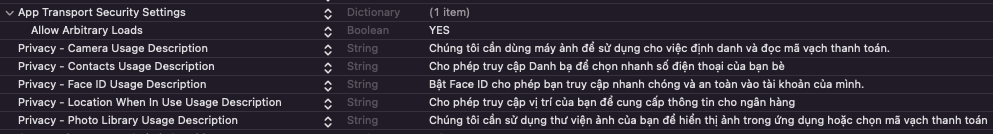
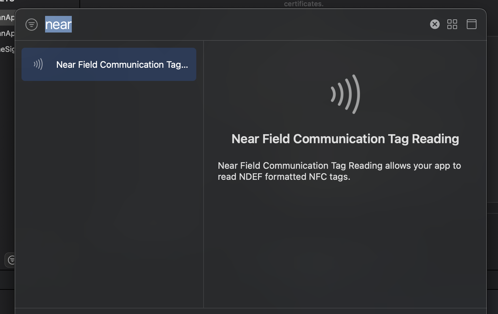
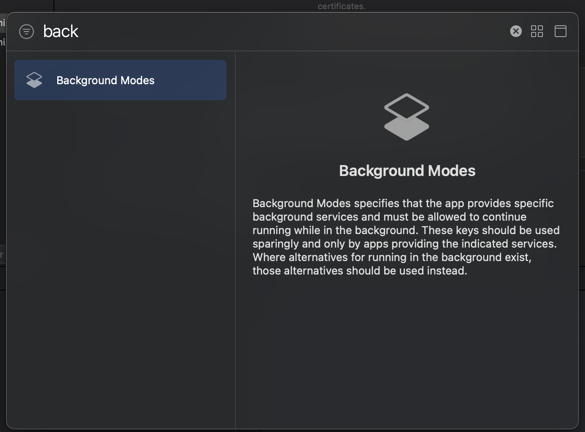
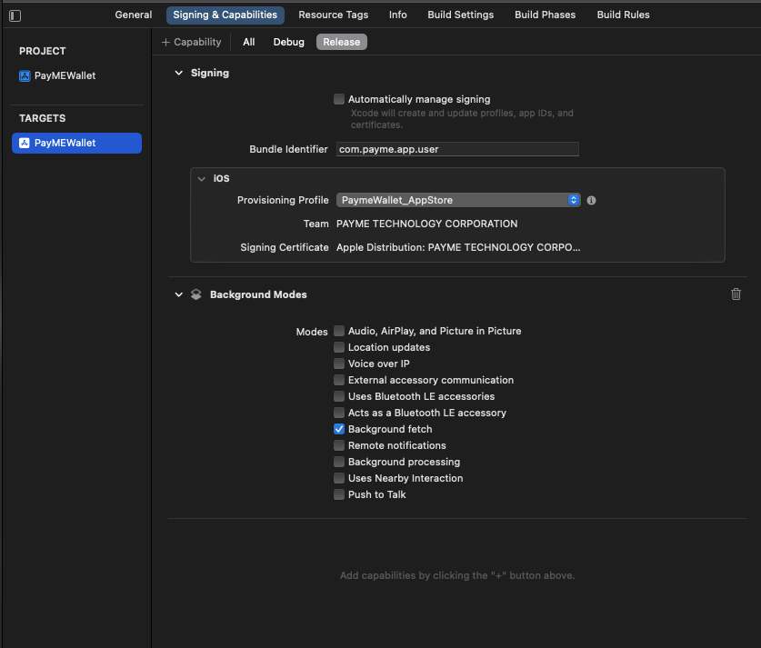

# PayME Miniapp Flutter

**Tiếng Việt** | [English](README.en.md)

Plugin Flutter `payme_miniapp_flutter` giúp ứng dụng của đối tác mở PayME Miniapp (ví, thanh toán, nạp, rút, chuyển tiền, dịch vụ, KYC) trên iOS và Android.

| Thành phần | Phiên bản |
| --- | --- |
| `payme_miniapp_flutter` (pub.dev) | **3.0.0** |
| PayME Miniapp iOS (CocoaPods `PayME-Miniapp`) | 0.8.1 |
| PayME Miniapp Android (`com.github.PayME-Miniapp:native-android`) | 0.8.2 |
| PayME SDK | 1.0.24 |

> [!IMPORTANT]
> 3.0.0 là bản không tương thích ngược với 2.x: mọi chỗ trước đây nhận số điện thoại (`phone`) nay nhận `identityToken`. Xem [Nâng cấp từ 2.x](#nâng-cấp-từ-2x).

## Mục lục

- [Yêu cầu](#yêu-cầu)
- [Cài đặt](#cài-đặt)
  - [Thêm thư viện](#thêm-thư-viện)
  - [iOS: Podfile](#ios-podfile)
  - [Android: JitPack và Gradle](#android-jitpack-và-gradle)
- [Cấu hình ứng dụng](#cấu-hình-ứng-dụng)
  - [iOS: Info.plist](#ios-infoplist)
  - [iOS: Capabilities](#ios-capabilities)
  - [iOS: Background fetch và AppDelegate](#ios-background-fetch-và-appdelegate)
  - [Android: quyền, Activity và ProGuard](#android-quyền-activity-và-proguard)
- [Bắt đầu nhanh](#bắt-đầu-nhanh)
- [identityToken](#identitytoken)
- [Tham chiếu API](#tham-chiếu-api)
  - [Lưu ý chung về Future](#lưu-ý-chung-về-future)
  - [init](#init)
  - [open](#open)
  - [PayMEOpeningParam](#paymeopeningparam)
  - [Các lớp tham số](#các-lớp-tham-số)
  - [getBalance](#getbalance)
  - [getAccountInfo](#getaccountinfo)
  - [setLanguage](#setlanguage)
  - [close](#close)
  - [onResponse và onError](#onresponse-và-onerror)
  - [Hằng số](#hằng-số)
- [Mã lỗi](#mã-lỗi)
- [Nâng cấp từ 2.x](#nâng-cấp-từ-2x)
- [Lịch sử thay đổi và hỗ trợ](#lịch-sử-thay-đổi-và-hỗ-trợ)

## Yêu cầu

| Hạng mục | Yêu cầu |
| --- | --- |
| Dart SDK | `>=3.2.0 <4.0.0` |
| Flutter | `>=3.3.0` (phiên bản Flutter phải build được với Android Gradle Plugin 9, xem bên dưới) |
| iOS | iOS 13.0 trở lên, **Xcode 26.2 trở lên**, CocoaPods |
| Android | `minSdkVersion` 26, `targetSdkVersion` 33 trở lên, `compileSdkVersion` 37 |
| Android build | JDK 17, Gradle 9.3.1, Android Gradle Plugin 9.1.1, Kotlin Gradle Plugin 2.2.20, NDK 28.2.13676358 |
| Tài khoản | `appId`, `publicKey`, `privateKey` do PayME cấp; server của đối tác gọi được API cấp `identityToken` của PayME |

## Cài đặt

### Thêm thư viện

```sh
flutter pub add payme_miniapp_flutter
```

hoặc khai báo trong `pubspec.yaml`:

```yaml
dependencies:
  payme_miniapp_flutter: ^3.0.0
```

### iOS: Podfile

Plugin kéo pod `PayME-Miniapp` 0.8.1. Một số pod phụ thuộc phải build dưới dạng dynamic framework. Cập nhật `ios/Podfile`:

```ruby
platform :ios, '13.0'

target 'Runner' do
  use_frameworks!
  use_modular_headers!

  flutter_install_all_ios_pods File.dirname(File.realpath(__FILE__))

  $dynamic_frameworks = [
    'PayME-Miniapp', 'CryptoSwift', 'SwiftyRSA', 'GCDWebServer', 'NSLogger',
    'lottie-ios', 'SwiftyJSON', 'ZIPFoundation', 'Mixpanel-swift'
  ]

  pre_install do |installer|
    installer.pod_targets.each do |pod|
      if $dynamic_frameworks.include?(pod.name)
        def pod.build_type
          Pod::BuildType.dynamic_framework
        end
      end
    end
  end

  post_install do |installer|
    installer.pods_project.targets.each do |target|
      flutter_additional_ios_build_settings(target)
      target.build_configurations.each do |config|
        if $dynamic_frameworks.include?(target.name)
          config.build_settings['BUILD_LIBRARY_FOR_DISTRIBUTION'] = 'YES'
          config.build_settings['IPHONEOS_DEPLOYMENT_TARGET'] = '13.0'
        end
      end
    end
  end
end
```

Sau đó chạy:

```sh
cd ios && pod install --repo-update
```

### Android: JitPack và Gradle

**1. Thêm JitPack.** Thư viện native Android được phát hành qua JitPack, nên project ứng dụng phải khai báo repository này.

Nếu project khai báo repository trong `android/build.gradle`:

```groovy
allprojects {
    repositories {
        google()
        mavenCentral()
        maven { url "https://jitpack.io" }
    }
}
```

Nếu project dùng `dependencyResolutionManagement` trong `android/settings.gradle`:

```groovy
dependencyResolutionManagement {
    repositories {
        google()
        mavenCentral()
        maven { url = uri("https://jitpack.io") }
    }
}
```

**2. Android Gradle Plugin và Kotlin.** Với template Flutter mới, trong `android/settings.gradle`:

```groovy
plugins {
    id "dev.flutter.flutter-plugin-loader" version "1.0.0"
    id "com.android.application" version "9.1.1" apply false
    id "org.jetbrains.kotlin.android" version "2.2.20" apply false
}
```

Với template cũ khai báo trong `android/build.gradle`:

```groovy
buildscript {
    ext.kotlin_version = "2.2.20"
    dependencies {
        classpath "com.android.tools.build:gradle:9.1.1"
        classpath "org.jetbrains.kotlin:kotlin-gradle-plugin:$kotlin_version"
    }
}
```

**3. Gradle Wrapper** (`android/gradle/wrapper/gradle-wrapper.properties`):

```properties
distributionUrl=https\://services.gradle.org/distributions/gradle-9.3.1-all.zip
```

**4. Module app** (`android/app/build.gradle`):

```groovy
android {
    compileSdkVersion 37
    ndkVersion = "28.2.13676358"

    defaultConfig {
        minSdkVersion 26
        targetSdkVersion flutter.targetSdkVersion // phải từ 33 trở lên
    }
}
```

**5. `android/gradle.properties`:**

```properties
android.useAndroidX=true
android.enableJetifier=true
android.builtInKotlin=false
android.newDsl=false
android.uniquePackageNames=false
```

`android.builtInKotlin=false` và `android.newDsl=false` giữ project build bằng Kotlin Gradle Plugin trong giai đoạn Flutter và AGP 9 chuyển sang Built-in Kotlin. `android.uniquePackageNames=false` là cách xử lý tạm thời cho lỗi trùng namespace giữa `com.google.ai.edge.litert:litert-support` và `com.google.ai.edge.litert:litert-support-api` khi build với AGP 9.

## Cấu hình ứng dụng

### iOS: Info.plist

Thêm các key sau vào `ios/Runner/Info.plist`:



```xml
<key>LSApplicationQueriesSchemes</key>
<array>
  <string>vcbpartner</string>
</array>
<key>NSCameraUsageDescription</key>
<string>Ứng dụng cần dùng máy ảnh để định danh và quét mã thanh toán</string>
<key>NSContactsUsageDescription</key>
<string>Ứng dụng cần truy cập danh bạ để chọn nhanh số điện thoại</string>
<key>NSPhotoLibraryAddUsageDescription</key>
<string>Ứng dụng cần quyền lưu ảnh mã QR vào thư viện ảnh</string>
<key>NSPhotoLibraryUsageDescription</key>
<string>Ứng dụng cần truy cập thư viện ảnh để chọn mã QR</string>
<key>NFCReaderUsageDescription</key>
<string>Ứng dụng cần dùng NFC để đọc căn cước công dân khi định danh (eKYC)</string>
<key>com.apple.developer.nfc.readersession.iso7816.select-identifiers</key>
<array>
  <string>A0000002471001</string>
  <string>A0000002472001</string>
  <string>00000000000000</string>
</array>
```

| Key | Mục đích |
| --- | --- |
| `LSApplicationQueriesSchemes` | Mở app ngân hàng Vietcombank (`vcbpartner`) khi nạp tiền qua deeplink |
| `NSCameraUsageDescription` | Chụp giấy tờ, khuôn mặt khi KYC; quét mã QR |
| `NSContactsUsageDescription` | Chọn số trong danh bạ khi nạp tiền điện thoại |
| `NSPhotoLibraryUsageDescription` | Chọn ảnh mã QR từ thư viện |
| `NSPhotoLibraryAddUsageDescription` | Lưu ảnh mã QR vào thư viện |
| `NFCReaderUsageDescription` | Đọc chip căn cước công dân qua NFC khi KYC |
| `com.apple.developer.nfc.readersession.iso7816.select-identifiers` | Mã ứng dụng ISO 7816 cho phiên đọc NFC |

### iOS: Capabilities

Trong Xcode, chọn target `Runner` > **Signing & Capabilities** > nhấn **+ Capability**, rồi thêm:

1. **Near Field Communication Tag Reading** (KYC qua NFC).

   

2. **Background Modes**, bật **Background fetch** (PayME Miniapp tải bản cập nhật ở nền).

   

   

### iOS: Background fetch và AppDelegate

Để Miniapp hoàn tất việc tải bản cập nhật ở nền, thêm handler `handleEventsForBackgroundURLSession` vào `ios/Runner/AppDelegate.swift`:

```swift
import Flutter
import UIKit

@main
@objc class AppDelegate: FlutterAppDelegate {
  override func application(
    _ application: UIApplication,
    didFinishLaunchingWithOptions launchOptions: [UIApplication.LaunchOptionsKey: Any]?
  ) -> Bool {
    GeneratedPluginRegistrant.register(with: self)
    return super.application(application, didFinishLaunchingWithOptions: launchOptions)
  }

  override func application(
    _ application: UIApplication,
    handleEventsForBackgroundURLSession identifier: String,
    completionHandler: @escaping () -> Void
  ) {
    completionHandler()
  }
}
```

Nếu AppDelegate viết bằng Objective-C (`AppDelegate.m`):

```objective-c
- (void)application:(UIApplication *)application
    handleEventsForBackgroundURLSession:(NSString *)identifier
                      completionHandler:(void (^)(void))completionHandler {
  completionHandler();
}
```

### Android: quyền, Activity và ProGuard

- **Quyền:** thư viện native đã khai báo sẵn các quyền cần thiết (Internet, máy ảnh, danh bạ, NFC, ...) trong manifest của nó; Gradle tự gộp vào ứng dụng. Không cần khai báo thêm.
- **Activity:** `MainActivity` giữ nguyên `FlutterActivity`, không cần đổi sang `FlutterFragmentActivity`. Trên Android, plugin luôn mở Miniapp bằng một Activity riêng (toàn màn hình).
- **ProGuard / R8:** nếu bật `minifyEnabled true`, thêm vào `android/app/proguard-rules.pro`:

```proguard
-keep class vn.kalapa.ekyc.**{*;}
-keep class com.fis.ekyc.**{*;}
-keep class com.fis.nfc.**{*;}
-keep class retrofit2.**{*;}

-keepclassmembers,allowobfuscation class * {
    @com.google.gson.annotations.SerializedName <fields>;
}
```

## Bắt đầu nhanh

```dart
import 'package:flutter/foundation.dart';
import 'package:payme_miniapp_flutter/payme_miniapp_flutter.dart';
import 'package:payme_miniapp_flutter/payme_miniapp_type.dart';

/// Gọi server của bạn để lấy identityToken (xem mục identityToken).
Future<String> fetchIdentityToken() async => throw UnimplementedError();

void setUpPayME() {
  PaymeMiniappFlutter.onResponse.listen((event) => debugPrint('PayME response: $event'));
  PaymeMiniappFlutter.onError.listen((event) => debugPrint('PayME error: $event'));
  PaymeMiniappFlutter.init('<APP_ID>', '<PUBLIC_KEY>', '<PRIVATE_KEY>',
      env: PayMEEnv.SANDBOX, mode: PayMEMode.MINIAPP_SANDBOX);
}

Future<void> openWallet() async {
  final identityToken = await fetchIdentityToken();
  PaymeMiniappFlutter.open(
      PayMEOpeningType.screen, PayMEOpeningParam.open(identityToken: identityToken));
}
```

Gọi `setUpPayME()` một lần, càng sớm càng tốt khi ứng dụng khởi động (ví dụ trong `initState` của màn hình gốc): `init` đồng thời kiểm tra và tải bản Miniapp mới nhất. Kết quả và lỗi của mọi thao tác đều trả về qua hai stream `onResponse` và `onError`, không qua giá trị trả về của hàm.

## identityToken

`identityToken` là chuỗi do backend PayME ký cho một người dùng của đối tác. Từ 3.0.0, Miniapp xác định người dùng bằng chuỗi này thay cho số điện thoại.

**Luồng 3 bước**

1. **Server đối tác lấy chuỗi.** Server của bạn gọi API `identityToken/init` của PayME (server tới server) với số điện thoại của người dùng. Liên hệ PayME để nhận tài liệu API này. Không gọi API này từ ứng dụng.
2. **Ứng dụng nhận chuỗi.** Ứng dụng lấy `identityToken` từ server của bạn qua kênh đã xác thực người dùng.
3. **Mở Miniapp.** Truyền chuỗi vào `PayMEOpeningParam` (hoặc `getBalance`, `getAccountInfo`).

**Thời hạn**

- Chuỗi có hiệu lực **15 phút** kể từ khi cấp và dùng lại được nhiều lần trong thời gian đó.
- Chuỗi sai hoặc hết hạn: `onError` trả `code` `"401"`. Lấy chuỗi mới từ server rồi gọi lại.
- Chuỗi rỗng ở thao tác bắt buộc: `onError` trả `code` `"IDENTITY_TOKEN_REQUIRED"`.

**Khi nào cần**

| Thao tác | identityToken |
| --- | --- |
| `PayMEOpeningParam.payme()` | Không dùng. Người dùng tự nhập số điện thoại và đăng nhập bằng PIN. |
| `PayMEOpeningParam.payment(...)` | Tuỳ chọn. Có: trả được bằng ví PayME. Không có: thanh toán như khách vãng lai (thẻ, QR). |
| Các `PayMEOpeningParam` còn lại, `getBalance`, `getAccountInfo` | Bắt buộc |

**Bảo mật**

- Chỉ giữ chuỗi trong bộ nhớ. Không ghi log, không lưu xuống máy (SharedPreferences, file, cơ sở dữ liệu), không đưa lên URL hay analytics.
- Không nhúng `privateKey` hay thông tin gọi API `identityToken/init` vào ứng dụng; chỉ server của bạn giữ chúng.

## Tham chiếu API

Mọi hàm là `static` trên lớp `PaymeMiniappFlutter` (`package:payme_miniapp_flutter/payme_miniapp_flutter.dart`). Các lớp tham số và hằng số nằm trong `package:payme_miniapp_flutter/payme_miniapp_type.dart`.

### Lưu ý chung về Future

- Các hàm trả về `Future<dynamic>` nhưng **không mang dữ liệu**. Kết quả và lỗi nghiệp vụ đến qua [`onResponse` và `onError`](#onresponse-và-onerror).
- Plugin tự bắt mọi `PlatformException` từ native, chỉ in ra bằng `debugPrint` và trả `null`. Ứng dụng **không nhận được exception** khi gọi các hàm này (xem [Mã lỗi](#mã-lỗi)).
- Trên một số nền tảng, Future có thể không bao giờ hoàn tất (ví dụ `init`, `open` trên iOS). Không đặt logic quan trọng phía sau `await` của các hàm này; gọi xong là đủ.

### init

```dart
static Future<dynamic> init(String appId, String publicKey, String privateKey,
    {String? locale = PayMELocale.VI,
    String? env = PayMEEnv.PRODUCTION,
    String? mode = 'miniapp_product'});
```

| Tham số | Bắt buộc | Kiểu | Mặc định | Mô tả |
| --- | --- | --- | --- | --- |
| `appId` | Có | `String` | | Mã ứng dụng PayME cấp (giá trị `x-api-client` trên dashboard) |
| `publicKey` | Có | `String` | | Public key RSA PayME cấp, viết trên một dòng (bỏ ký tự xuống dòng) |
| `privateKey` | Có | `String` | | Private key RSA của đối tác, viết trên một dòng |
| `locale` | Không | `String` | `PayMELocale.VI` | Ngôn ngữ ban đầu: `PayMELocale.VI`, `PayMELocale.EN` |
| `env` | Không | `String` | `PayMEEnv.PRODUCTION` | `PayMEEnv.SANDBOX` hoặc `PayMEEnv.PRODUCTION` |
| `mode` | Không | `String` | `PayMEMode.MINIAPP_PRODUCT` | `PayMEMode.MINIAPP_SANDBOX` hoặc `PayMEMode.MINIAPP_PRODUCT`; dùng cặp khớp với `env` |

> [!WARNING]
> Không commit key thật vào mã nguồn public, README hay ảnh chụp màn hình. Dùng bộ key PayME cấp riêng cho từng môi trường.

### open

```dart
static Future<dynamic> open(String type, PayMEOpeningParam openingParam);
```

| Tham số | Bắt buộc | Kiểu | Mô tả |
| --- | --- | --- | --- |
| `type` | Có | `String` | `PayMEOpeningType.screen` (toàn màn hình) hoặc `PayMEOpeningType.modal` (trượt từ dưới lên). Trên Android plugin luôn mở toàn màn hình. |
| `openingParam` | Có | `PayMEOpeningParam` | Thao tác cần mở, tạo bằng một trong các named constructor bên dưới |

```dart
void payOrder(String identityToken) {
  PaymeMiniappFlutter.open(
    PayMEOpeningType.screen,
    PayMEOpeningParam.pay(
      identityToken: identityToken,
      data: PayMEPaymentParam(amount: 10000, transactionId: '<PARTNER_ORDER_ID>'),
    ),
  );
}
```

### PayMEOpeningParam

| Named constructor | Action | `identityToken` | `data` | Mô tả |
| --- | --- | --- | --- | --- |
| `PayMEOpeningParam.payme()` | `PAYME` | Không dùng | Không | Mở ví PayME; người dùng tự đăng nhập bằng số điện thoại và PIN |
| `PayMEOpeningParam.open(identityToken:)` | `OPEN` | Bắt buộc | Không | Mở trang chủ ví; kích hoạt ví nếu người dùng chưa có |
| `PayMEOpeningParam.pay(identityToken:, data:)` | `PAY` | Bắt buộc | `PayMEPaymentParam` (bắt buộc) | Thanh toán đơn hàng |
| `PayMEOpeningParam.payment(identityToken:, data:)` | `PAYMENT` | Tuỳ chọn | `PayMEPaymentDirectParam` (bắt buộc) | Thanh toán giao dịch đối tác đã tạo sẵn qua API PayME |
| `PayMEOpeningParam.transferQR(identityToken:, data:)` | `TRANSFER_QR` | Bắt buộc | `PayMETransferQRParam` (bắt buộc) | Chuyển tiền từ ví PayME tới tài khoản ngân hàng đích |
| `PayMEOpeningParam.service(identityToken:, data:)` | `SERVICE` | Bắt buộc | `PayMEServiceParam` (bắt buộc) | Thanh toán dịch vụ (điện, nước, thẻ, ...) |
| `PayMEOpeningParam.deposit(identityToken:, data:)` | `DEPOSIT` | Bắt buộc | `PayMEPayParam` (bắt buộc) | Nạp tiền vào ví |
| `PayMEOpeningParam.withdraw(identityToken:, data:)` | `WITHDRAW` | Bắt buộc | `PayMEPayParam` (bắt buộc) | Rút tiền từ ví |
| `PayMEOpeningParam.transfer(identityToken:, data:)` | `TRANSFER` | Bắt buộc | `PayMEPayParam` (bắt buộc) | Chuyển tiền |
| `PayMEOpeningParam.kyc(identityToken:)` | `KYC` | Bắt buộc | Không | Mở luồng định danh (KYC) |

Với `PAYMENT`, đối tác lấy danh sách phương thức và tạo giao dịch qua API PayME (liên hệ PayME), rồi truyền mã giao dịch vào `PayMEPaymentDirectParam.transaction`.

Ví dụ:

```dart
void buildParams(String identityToken) {
  // Ví PayME, không cần identityToken
  final wallet = PayMEOpeningParam.payme();

  // Thanh toán giao dịch có sẵn; bỏ identityToken để thanh toán như khách vãng lai
  final payment = PayMEOpeningParam.payment(data: PayMEPaymentDirectParam(transaction: '<TRANSACTION>'));

  // Chuyển tiền tới tài khoản ngân hàng
  final transferQR = PayMEOpeningParam.transferQR(
    identityToken: identityToken,
    data: PayMETransferQRParam(
      amount: 20000,
      bankNumber: '<BANK_ACCOUNT_NUMBER>',
      swiftCode: '<SWIFT_CODE>',
      cardHolder: '<ACCOUNT_HOLDER_NAME>',
    ),
  );

  // Thanh toán dịch vụ điện
  final service = PayMEOpeningParam.service(identityToken: identityToken, data: PayMEServiceParam(service: 'POWE'));

  // Nạp tiền
  final deposit = PayMEOpeningParam.deposit(identityToken: identityToken, data: PayMEPayParam(amount: 10000));
}
```

### Các lớp tham số

Số tiền tính bằng VND và phải là số nguyên (kể cả khi kiểu Dart là `double`).

**`PayMEPaymentParam`** (dùng cho `pay`)

| Thuộc tính | Bắt buộc | Kiểu | Mô tả |
| --- | --- | --- | --- |
| `amount` | Có | `int` | Số tiền giao dịch |
| `transactionId` | Có | `String` | Mã giao dịch của đối tác |
| `note` | Không | `String?` | Ghi chú |
| `ipnUrl` | Không | `String?` | URL server PayME gọi (IPN) khi giao dịch thành công hoặc thất bại |
| `isShowResult` | Không | `bool?` | Hiện màn hình kết quả của PayME (mặc định `true`) |

**`PayMEPaymentDirectParam`** (dùng cho `payment`)

| Thuộc tính | Bắt buộc | Kiểu | Mô tả |
| --- | --- | --- | --- |
| `transaction` | Có | `String` | Mã giao dịch đã tạo qua API PayME |
| `isShowResult` | Không | `bool?` | Hiện màn hình kết quả của PayME (mặc định `true`) |

**`PayMETransferQRParam`** (dùng cho `transferQR`)

| Thuộc tính | Bắt buộc | Kiểu | Mô tả |
| --- | --- | --- | --- |
| `amount` | Có | `double` | Số tiền (truyền `0` nếu để người dùng tự nhập) |
| `bankNumber` | Có | `String` | Số tài khoản hoặc số thẻ đích |
| `swiftCode` | Có | `String` | Mã SWIFT của ngân hàng đích |
| `cardHolder` | Có | `String` | Tên chủ tài khoản |
| `note` | Không | `String?` | Ghi chú |
| `partnerTransaction` | Không | `String?` | Mã giao dịch của đối tác |
| `extraData` | Không | `Map<String, dynamic>?` | Dữ liệu tuỳ ý của đối tác, trả lại khi giao dịch thành công |
| `isShowResult` | Không | `bool?` | Hiện màn hình kết quả của PayME (mặc định `true`) |

**`PayMEServiceParam`** (dùng cho `service`)

| Thuộc tính | Bắt buộc | Kiểu | Mô tả |
| --- | --- | --- | --- |
| `service` | Có | `String` | Mã dịch vụ (bảng dưới) |
| `isBackToApp` | Không | `bool?` | Quay về ứng dụng đối tác sau khi hoàn tất |
| `isShowResult` | Không | `bool?` | Hiện màn hình kết quả của PayME (mặc định `true`) |

| Mã dịch vụ | Dịch vụ |
| --- | --- |
| `POWE` | Điện |
| `WATE` | Nước |
| `ADSL` | Internet |
| `TIVI` | Truyền hình |
| `PPMB` | Điện thoại trả sau |
| `MOBILE_CARD` | Thẻ điện thoại |
| `MOBILE_TOPUP` | Nạp tiền điện thoại |
| `GAME_CARD` | Thẻ game |

**`PayMEPayParam`** (dùng cho `deposit`, `withdraw`, `transfer`)

| Thuộc tính | Bắt buộc | Kiểu | Mô tả |
| --- | --- | --- | --- |
| `amount` | Không | `double?` | Số tiền gợi ý |
| `description` | Không | `String?` | Mô tả giao dịch |
| `isBackToApp` | Không | `bool?` | Quay về ứng dụng đối tác sau khi hoàn tất |
| `isShowResult` | Không | `bool?` | Hiện màn hình kết quả của PayME (mặc định `true`) |

### getBalance

```dart
static Future<dynamic> getBalance(String identityToken);
```

Lấy số dư ví của người dùng. Kết quả về `onResponse` với `action` `GET_BALANCE`:

| Trường | Kiểu | Mô tả |
| --- | --- | --- |
| `linked` | `bool` | Người dùng đã liên kết ví với ứng dụng hay chưa |
| `balance` | `int` | Số dư (VND); chỉ có khi `linked` là `true` |
| `message` | `String` | Thông điệp kèm theo |

### getAccountInfo

```dart
static Future<dynamic> getAccountInfo(String identityToken);
```

Lấy thông tin tài khoản PayME. Kết quả về `onResponse` với `action` `GET_ACCOUNT_INFO`, kèm các trường thông tin tài khoản do PayME trả về (ví dụ `accountId`).

Cả hai hàm đều trả lỗi qua `onError`: `"401"` khi `identityToken` sai hoặc hết hạn, `"IDENTITY_TOKEN_REQUIRED"` khi chuỗi rỗng.

### setLanguage

```dart
static Future<dynamic> setLanguage(String language);
```

Đổi ngôn ngữ Miniapp sau khi đã `init`. `language` là `PayMELocale.VI` (`'vi'`) hoặc `PayMELocale.EN` (`'en'`).

### close

```dart
static Future<dynamic> close();
```

Đóng Miniapp đang mở. **Hiện chỉ có tác dụng trên Android**; trên iOS plugin chưa hỗ trợ lệnh này (lời gọi bị bỏ qua).

### onResponse và onError

```dart
static Stream<dynamic> get onResponse;
static Stream<dynamic> get onError;
```

Đây là broadcast stream; đăng ký một lần trước khi gọi `open`, `getBalance` hay `getAccountInfo`, và huỷ `StreamSubscription` khi không dùng nữa.

| Stream | Kiểu sự kiện | Nội dung |
| --- | --- | --- |
| `onResponse` | `Map` | `action` (`String`) cộng các trường kết quả của thao tác đó, ví dụ `{action: GET_BALANCE, linked: true, balance: 150000, message: ...}` |
| `onError` | `Map` | `{action: String, code: String, description: String}` |
| `onError` (chỉ Android, lỗi phía plugin) | `String` | Thông điệp lỗi, ví dụ `Missing info`, `Missing action` |

Giá trị `action`: `PAYME`, `OPEN`, `PAY`, `PAYMENT`, `TRANSFER_QR`, `SERVICE`, `DEPOSIT`, `WITHDRAW`, `TRANSFER`, `KYC`, `GET_BALANCE`, `GET_ACCOUNT_INFO`.

```dart
final errorSub = PaymeMiniappFlutter.onError.listen((event) {
  if (event is! Map) {
    debugPrint('PayME plugin error: $event'); // Android: lỗi tham số phía plugin
    return;
  }
  final code = event['code'] as String?;
  switch (code) {
    case '401':
    case 'IDENTITY_TOKEN_REQUIRED':
      // Lấy identityToken mới từ server rồi mở lại Miniapp.
      break;
    case 'USER_CANCEL':
      // Miniapp đã đóng; thường không cần báo lỗi cho người dùng.
      break;
    default:
      debugPrint('PayME ${event['action']} lỗi $code: ${event['description']}');
  }
});

// Khi không dùng nữa:
// errorSub.cancel();
```

### Hằng số

| Lớp | Hằng số | Giá trị |
| --- | --- | --- |
| `PayMEEnv` | `SANDBOX`, `PRODUCTION` | `'SANDBOX'`, `'PRODUCTION'` |
| `PayMEMode` | `MINIAPP_SANDBOX`, `MINIAPP_PRODUCT` | `'miniapp_sandbox'`, `'miniapp_product'` |
| `PayMELocale` | `VI`, `EN` | `'vi'`, `'en'` |
| `PayMEOpeningType` | `screen`, `modal` | `'screen'`, `'modal'` |

## Mã lỗi

**Lỗi nhận qua `onError`** (`event['code']`)

| Mã | Khi nào | Cách xử lý |
| --- | --- | --- |
| `401` | `identityToken` sai hoặc hết hạn (mở Miniapp, `getBalance`, `getAccountInfo`). Miniapp tự đóng. | Gọi server lấy `identityToken` mới rồi thực hiện lại. |
| `IDENTITY_TOKEN_REQUIRED` | `identityToken` rỗng ở thao tác bắt buộc | Kiểm tra luồng lấy chuỗi; không mở Miniapp khi chưa có chuỗi. |
| `USER_CANCEL` | Miniapp đóng (người dùng đóng hoặc thoát) | Coi là sự kiện đóng Miniapp, không phải lỗi hệ thống. Trên iOS mã này được gửi mỗi khi màn hình Miniapp đóng. |
| `SYSTEM_CANCEL` | (iOS) Miniapp không khởi động được | Thử mở lại; nếu lặp lại, báo PayME. |
| `CONNECTION_LOST`, `TIMED_OUT`, `NO_RESPONSE` | Lỗi mạng hoặc server không phản hồi | Báo người dùng kiểm tra kết nối và thử lại. |
| `ENCODE_FAILED`, `DECODE_FAILED` | Lỗi mã hoá hoặc giải mã dữ liệu, thường do sai key hoặc sai môi trường | Kiểm tra `appId`, cặp key và cặp `env`/`mode`. |
| `SERVER` (iOS), `SERVER_ERROR` (Android) | Server PayME trả lỗi | Thử lại sau; hiển thị `description`. |
| `OTHER` | Lỗi khác (ví dụ không tìm thấy thông tin tài khoản) | Hiển thị `description`. |
| Mã khác | Lỗi nghiệp vụ do Miniapp trả về | Hiển thị `description`; liên hệ PayME nếu cần tra cứu. |

**Lỗi phía plugin (`PlatformException`)**

Các mã dưới đây do lớp native của plugin trả về qua MethodChannel. Plugin bắt chúng bên trong Dart, chỉ in bằng `debugPrint` (dạng `Error invoking method: PlatformException(...)`) và Future trả `null`; ứng dụng không nhận được exception. Trên Android, một số trường hợp còn gửi kèm một chuỗi `String` lên `onError`. Hãy kiểm tra tham số trước khi gọi và đọc log debug khi tích hợp.

| Mã | Nền tảng | Khi nào | Cách xử lý |
| --- | --- | --- | --- |
| `MISSING_INFO` | iOS, Android | Thiếu tham số (`init` thiếu key, `getBalance`/`getAccountInfo`/`setLanguage` thiếu đối số) | Truyền đủ tham số. |
| `INVALID_PARAM` | iOS | `data` thiếu hoặc sai kiểu cho action (ví dụ `pay` không có `amount`, số tiền không nguyên) | Truyền đúng lớp tham số và trường bắt buộc. |
| `PAYME_NOT_INITIALIZED` | iOS | Gọi `open`/`getBalance`/`getAccountInfo`/`setLanguage` trước `init` | Gọi `init` khi ứng dụng khởi động. |
| `JSON_PARSE_ERROR` | Android | `init` nhận tham số không hợp lệ (ví dụ `locale`, `env` hoặc `mode` là `null`) | Không truyền `null`; bỏ tham số để dùng mặc định. |
| `ERROR` | Android | Lỗi bất ngờ khi `open` | Xem log; báo PayME kèm thông tin tái hiện. |

> [!NOTE]
> Trên Android, nếu thiếu `data` bắt buộc cho `pay`, `payment`, `transferQR` hay `service`, plugin không báo `INVALID_PARAM` mà mở giao diện ví PayME. Luôn truyền đủ `data` cho các action này.

## Nâng cấp từ 2.x

| 2.x (SDK native iOS 0.7.6 / Android 0.7.2) | 3.0.0 (SDK native iOS 0.8.1 / Android 0.8.2) |
| --- | --- |
| `PayMEOpeningParam.open(phone: phone)` | `PayMEOpeningParam.open(identityToken: identityToken)` |
| `PayMEOpeningParam.pay(phone: phone, data: ...)` | `PayMEOpeningParam.pay(identityToken: identityToken, data: ...)` |
| `PayMEOpeningParam.payment(data: ...)` | `PayMEOpeningParam.payment(identityToken: identityToken /* tuỳ chọn */, data: ...)` |
| `PayMEOpeningParam.transferQR(phone: phone, data: ...)` | `PayMEOpeningParam.transferQR(identityToken: identityToken, data: ...)` |
| `PayMEOpeningParam.service(phone: phone, data: ...)` | `PayMEOpeningParam.service(identityToken: identityToken, data: ...)` |
| `PayMEOpeningParam.deposit` / `withdraw` / `transfer(phone: phone, data: ...)` | `PayMEOpeningParam.deposit` / `withdraw` / `transfer(identityToken: identityToken, data: ...)` |
| `PayMEOpeningParam.kyc(phone: phone)` | `PayMEOpeningParam.kyc(identityToken: identityToken)` |
| (không có) | `PayMEOpeningParam.payme()` |
| `PaymeMiniappFlutter.getBalance(phone)` | `PaymeMiniappFlutter.getBalance(identityToken)` |
| `PaymeMiniappFlutter.getAccountInfo(phone)` | `PaymeMiniappFlutter.getAccountInfo(identityToken)` |

Các bước nâng cấp:

1. Đổi dependency thành `payme_miniapp_flutter: ^3.0.0`, chạy `flutter pub get` rồi `cd ios && pod install --repo-update`.
2. Dùng Xcode 26.2 trở lên để build iOS.
3. Xây dựng endpoint trên server để gọi API `identityToken/init` của PayME và trả chuỗi cho ứng dụng (xem [identityToken](#identitytoken)).
4. Thay mọi tham số `phone` bằng `identityToken` theo bảng trên.
5. Xử lý thêm mã `401` và `IDENTITY_TOKEN_REQUIRED` trong `onError`.

`init`, `setLanguage`, `close`, `onResponse`, `onError` và các lớp tham số `data` không thay đổi.

## Lịch sử thay đổi và hỗ trợ

- Lịch sử thay đổi: [pub.dev/packages/payme_miniapp_flutter/changelog](https://pub.dev/packages/payme_miniapp_flutter/changelog)
- Bộ key (`appId`, `publicKey`, `privateKey`), tài liệu API `identityToken/init`, API tạo giao dịch cho `PAYMENT` và tài khoản sandbox: liên hệ PayME.
